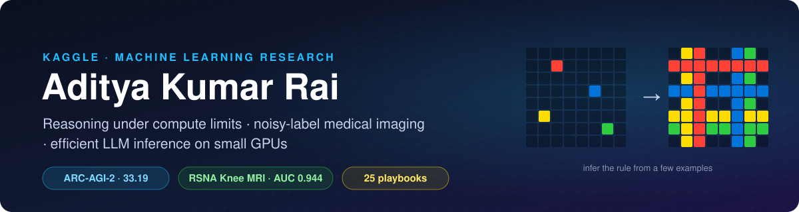

  

  
  
  
  

I compete on Kaggle and write up what I learn as research. My work is about **getting the most out of a fixed compute budget**: deciding how to split GPU-hours between test-time training and long chain-of-thought reasoning, serving 27B models on 24 GB cards offline, and fixing noisy labels when a new architecture won't help.

Every solution here ships with its code, an exact inference notebook, a technical report, and the experiments that *didn't* work.

## Competition work in numbers

<table>
  <tr>
    <td align="center"><a href="https://github.com/ADITYAKUMARRAI2007/compute-allocation-arc-agi-2"><strong>33.19</strong> ARC-AGI-2 score 4 × L4, 12 h, offline</a></td>
    <td align="center"><a href="https://github.com/ADITYAKUMARRAI2007/label-repair-knee-mri"><strong>0.944</strong> knee-MRI private AUC 12 findings, 9 h on 2 × T4</a></td>
    <td align="center"><a href="https://github.com/ADITYAKUMARRAI2007/label-repair-knee-mri/blob/main/docs/experiments.csv"><strong>77</strong> logged experiments RSNA alone, with outcomes</a></td>
    <td align="center"><a href="https://github.com/ADITYAKUMARRAI2007/kaggle-competition-playbooks"><strong>25</strong> domain playbooks distilled from top solutions</a></td>
  </tr>
</table>

## Solutions

| Competition | Year | Result | What made the difference | Write-up & code |
| --- | --- | --- | --- | --- |
| [**ARC Prize 2026**](https://www.kaggle.com/competitions/arc-prize-2026-arc-agi-2) · ARC-AGI-2 | 2026 | **33.19** public LB 29.72 TTT-only baseline | Moved compute from a test-time-trained 4B model to a 27B reasoning model at `xhigh` effort with 80k-token thinking budgets; patched a glibc-2.38 engine to run on 2.35 | [report](https://github.com/ADITYAKUMARRAI2007/compute-allocation-arc-agi-2/blob/main/docs/REPORT.md) · [code](https://github.com/ADITYAKUMARRAI2007/compute-allocation-arc-agi-2) (opens after the deadline) |
| [**RSNA Knee Abnormality Detection**](https://www.kaggle.com/competitions/rsna-knee-abnormality-detection) | 2026 | **0.944** private AUC 0.942 public-recipe baseline | Repaired labels for the noisiest findings and added per-finding specialists; four new architectures earned no blend weight | [report](https://github.com/ADITYAKUMARRAI2007/label-repair-knee-mri/blob/main/docs/REPORT.md) · [code](https://github.com/ADITYAKUMARRAI2007/label-repair-knee-mri) · [notebook](https://www.kaggle.com/code/adityakumarrai0401/rsna-knee-label-ft-coatnet-specialists-blend) |

<b>Findings I'd stake a claim on</b>

 

<table>
<tr>
<td width="50%"> <b>ARC:</b> same hardware and hours, but more reasoning-model time gives a higher hidden-set score.</td>
<td width="50%"> <b>RSNA:</b> label fixes moved the held-out score while the public leaderboard stayed flat.</td>
</tr>
</table>

- **`reasoning_effort` is not monotonic.** Qwen3.8-27B scores lower at `medium` than at `low`, because the chat template only injects instructions for `low` and `xhigh`.
- **Generation bounds selection.** 93% of failed ARC grids never had a correct candidate, so no judge or reranker could have recovered them.
- **A 58-study expert set** ranks models correctly but cannot resolve differences below 0.003 AUC. Use it as a gate, not for tuning.
- **Small public validations misled me in both directions**, in both competitions. I now only trust validations that match the test distribution and the time budget.

## What I am building now

| Project | Why it is here |
| --- | --- |
| [**kaggle-competition-playbooks**](https://github.com/ADITYAKUMARRAI2007/kaggle-competition-playbooks) | 25 structured playbooks (validation, label engineering, ensembling, vision, LLMs, time series, ARC, …) with case studies from top solutions, usable by humans and coding agents. |
| [**orderguard**](https://github.com/ADITYAKUMARRAI2007/orderguard) | Deterministic authorization for autonomous commerce agents: the agent proposes, only verified code can move money. |
| [**thermal-chaos-arena**](https://github.com/ADITYAKUMARRAI2007/thermal-chaos-arena) | A control benchmark for agents operating fragile GPU clusters. |
| [**genai-cli**](https://github.com/ADITYAKUMARRAI2007/genai-cli) | A tool-calling agent CLI with chain-of-thought execution. |

## Toolbox

  
  
  
  
  
  
  
  

## Get in touch

- Competition work: [Kaggle](https://www.kaggle.com/adityakumarrai0401)
- Code and write-ups: [GitHub](https://github.com/ADITYAKUMARRAI2007)
- Questions about a solution: open an issue in its repository.

  <a href="https://github.com/ADITYAKUMARRAI2007/compute-allocation-arc-agi-2">ARC-AGI-2</a>
  ·
  <a href="https://github.com/ADITYAKUMARRAI2007/label-repair-knee-mri">Knee MRI</a>
  ·
  <a href="https://github.com/ADITYAKUMARRAI2007/kaggle-competition-playbooks">Playbooks</a>
  ·
  <a href="https://www.kaggle.com/adityakumarrai0401">Kaggle</a>

