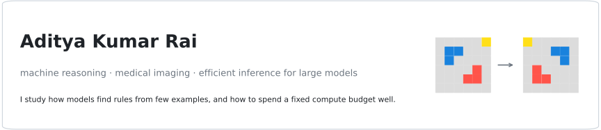
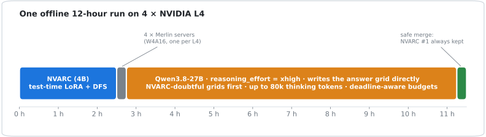
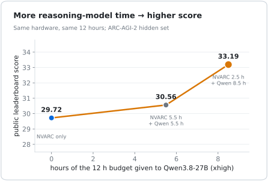
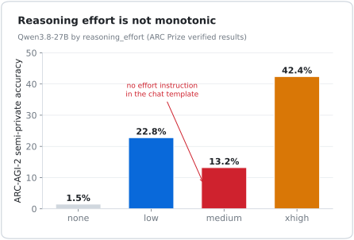
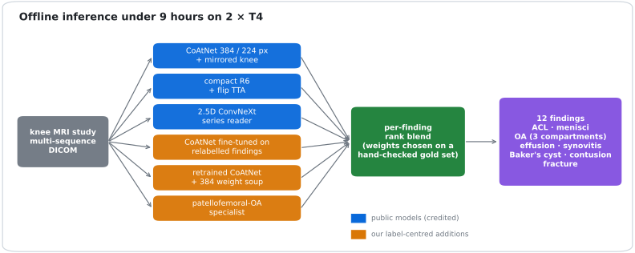
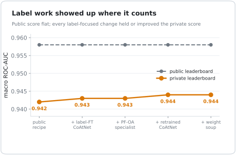

I work on two questions:

1. **How should a fixed compute budget be split between a small model that learns at test time and a large model that reasons?** Studied on ARC-AGI-2, the abstraction benchmark that frontier models still find hard.
2. **When labels are noisy, is it better to change the model or fix the labels?** Studied on knee MRI, with 12 findings across multi-sequence scans.

Both under hard limits: offline, a few consumer-class GPUs, a fixed number of hours.

---

## Reasoning under a compute budget · ARC-AGI-2

A 4B model with **test-time training** handles the puzzles it can learn quickly. A 27B reasoning model (**Qwen3.8-27B at `xhigh` effort**) spends the rest of a 12-hour budget writing answers directly. Serving 27B on 24 GB GPUs offline needed a quantised engine and a small **glibc binary patch** to run on Kaggle's image.

<table><tr>
<td width="50%"></td>
<td width="50%"></td>
</tr><tr>
<td>Giving the reasoning model more of the same budget raised the hidden-set score from <b>29.72 to 33.19</b>.</td>
<td>Effort settings are not monotonic: <code>medium</code> is worse than <code>low</code> because only <code>low</code>/<code>xhigh</code> add an instruction to the prompt.</td>
</tr></table>

**→ [arc-prize-2026-nvarc-qwen-hybrid](https://github.com/ADITYAKUMARRAI2007/arc-prize-2026-nvarc-qwen-hybrid)**: pipeline, ablations, negative results (code-writing answers, LLM-as-picker, candidate reconstruction).

---

## Labels over architectures · knee MRI

<table><tr>
<td width="55%"></td>
<td width="45%">New backbones (3D, EfficientNetV2, distilled students) never beat the blend. What moved the <b>held-out private score (0.942 → 0.944 macro AUC)</b> was rebuilding the noisiest labels from images and reports, per-finding specialists, and gating every change on a hand-checked gold set.</td>
</tr></table>

**→ [rsna-knee-mri-abnormality-detection](https://github.com/ADITYAKUMARRAI2007/rsna-knee-mri-abnormality-detection)** · [final notebook](https://www.kaggle.com/code/adityakumarrai0401/rsna-knee-label-ft-coatnet-specialists-blend)

---

## Notes I keep coming back to
* **Measure on the distribution you are judged on.** Small public-set checks repeatedly mispredicted held-out results, in both directions.
* **Effort, budget and allocation matter more than harness cleverness** for reasoning models at a fixed cost.
* **A wrong rule is not a typo.** Most reasoning failures were the wrong hypothesis, not slips in writing the answer, so fixing selection can't recover them.

**→ [kaggle-competition-playbooks](https://github.com/ADITYAKUMARRAI2007/kaggle-competition-playbooks)**: 25 research playbooks distilled from winning solutions across vision, language, LLMs and tabular data.

---

Also building agent systems: <a href="https://github.com/ADITYAKUMARRAI2007/orderguard">orderguard</a> (execution security for autonomous commerce agents) · <a href="https://github.com/ADITYAKUMARRAI2007/thermal-chaos-arena">thermal-chaos-arena</a> (control arena for fragile GPU clusters) · <a href="https://github.com/ADITYAKUMARRAI2007/genai-cli">genai-cli</a>. On Kaggle: <a href="https://www.kaggle.com/adityakumarrai0401">adityakumarrai0401</a>.
